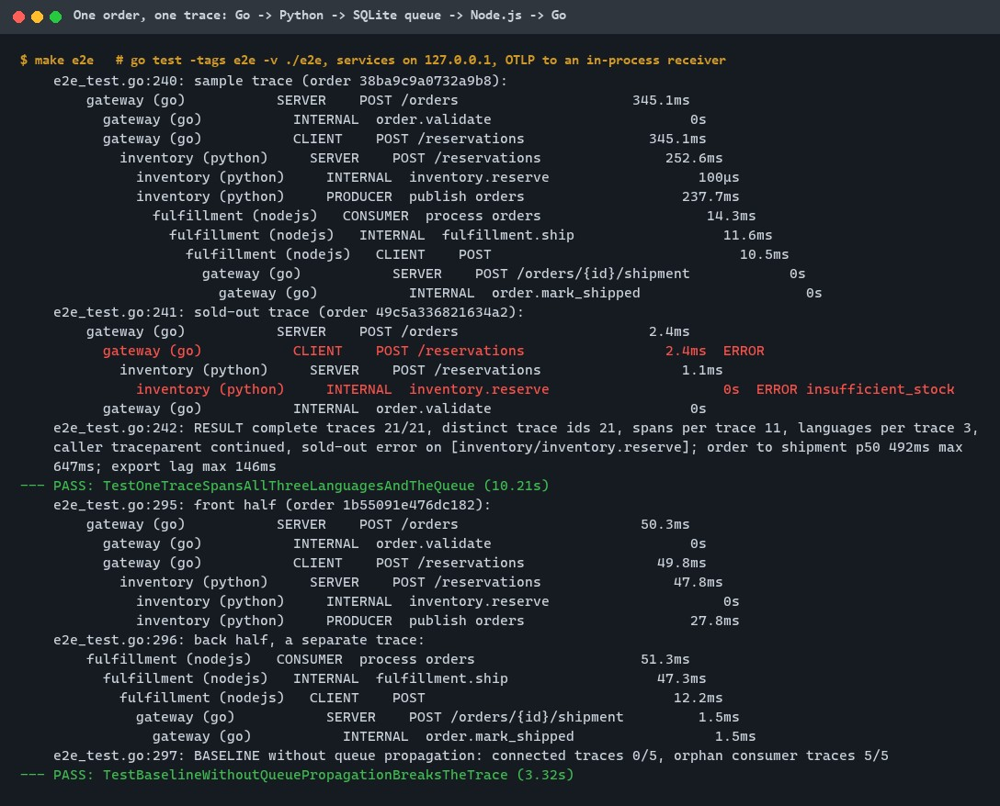
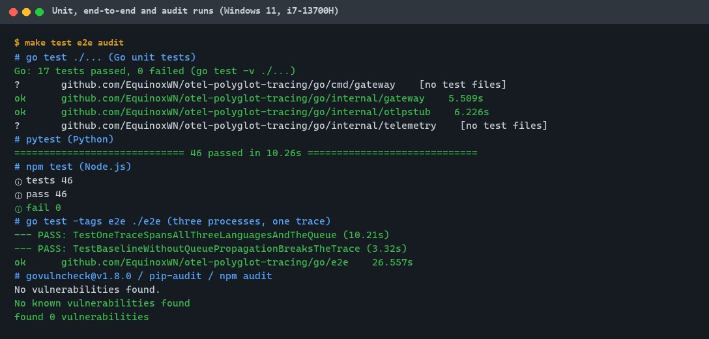
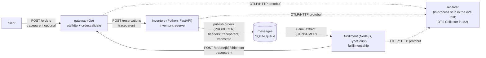

# otel-polyglot-tracing

[](https://github.com/EquinoxWN/otel-polyglot-tracing/actions/workflows/ci.yml)


> Find which service caused the slow request, across languages: one trace followed end to end, keeping the traces that matter.

Part of my **DevOps and Cloud** list · Go / Python / TS

## Proof it works

The end-to-end test runs the Go gateway, the Python inventory and the Node.js worker as real
processes on 127.0.0.1. All 21 orders came back as one trace each: 11 spans from three languages,
with the hop through the queue linked by W3C `traceparent`. The sold-out order's trace puts the
error in the inventory service. With trace propagation into the queue switched off (the baseline),
0 of 5 orders stay connected:



157 unit and end-to-end tests pass, and govulncheck, pip-audit and npm audit report nothing:



## Architecture

**What M1 runs today:**



**Full roadmap (M1 to M3):**


## How it works

_Steps 1 and 2 are built and tested (M1); the rest is on the [roadmap](#roadmap)._

1. Three services call each other over HTTP and a queue; OpenTelemetry SDKs create spans automatically, plus custom spans for business steps.
2. W3C trace-context headers carry the trace ID across languages and through the queue.
3. The Collector buffers whole traces and tail-samples them: keep every error and slow trace, and a small share of the rest.
4. Traces go to Jaeger for search and a service dependency graph.
5. Metric exemplars link a latency spike directly to an example trace.
6. A write-up compares storage cost of head sampling vs tail sampling.

In M1 one order produces this trace (the test checks every parent):

| Service | Span | Kind | Created by |
|---|---|---|---|
| gateway (Go) | `POST /orders` → `order.validate`, `POST /reservations` | SERVER, INTERNAL, CLIENT | `otelhttp` + custom span |
| inventory (Python) | `POST /reservations` → `inventory.reserve`, `publish orders` | SERVER, INTERNAL, PRODUCER | FastAPI instrumentation + custom spans; `propagate.inject` into the message headers |
| fulfillment (Node.js) | `process orders` → `fulfillment.ship` → `POST` | CONSUMER, INTERNAL, CLIENT | `propagation.extract` from the headers + custom spans; undici (fetch) instrumentation |
| gateway (Go) | `POST /orders/{id}/shipment` → `order.mark_shipped` | SERVER, INTERNAL | `otelhttp` + custom span |

## Who it helps

- **Who:** backend and platform engineers whose requests cross services written in different languages, with a queue in the middle; on-call engineers who must say which service made a request slow or fail.
- **The problem:** tracing breaks silently at language and queue boundaries, most often because the producer never puts the trace context into the message headers. The slow or failing half of the request then lands in a separate trace that nobody finds.
- **How to use it:** copy the inject/extract pattern (`python/.../inventory.py`, `js/src/worker.ts`) and the shared `OTEL_*` configuration into your services, and reuse the end-to-end test idea: run the real processes against an OTLP receiver you control, then assert span parents and languages, not just HTTP status codes. `make e2e` shows a working and a broken (baseline) trace side by side.

## Tech stack

| Area | In M1 | Planned |
|---|---|---|
| Services | Go 1.26 `net/http` gateway, Python FastAPI inventory, Node.js 24 TypeScript worker | - |
| Queue | SQLite table with message headers (Python `sqlite3`, Node `node:sqlite`), at-least-once with retries ([ADR 0002](docs/adr/0002-sqlite-queue-with-explicit-trace-headers.md)) | A real broker if throughput matters |
| Telemetry | OpenTelemetry SDKs (Go 1.47, Python 1.45, JS 2.12), `otelhttp`, FastAPI and undici instrumentation, W3C trace context + baggage, OTLP/HTTP protobuf | OTel Collector with tail sampling (M2) |
| Backend | In-process OTLP/HTTP receiver used by the e2e test ([`go/internal/otlpstub`](go/internal/otlpstub)) | Jaeger search and dependency graph (M2), exemplars in Grafana (M3) |
| Quality | gofmt, go vet, ruff, mypy `--strict`, tsc `--strict`, govulncheck, pip-audit, npm audit | - |

One implementation per language, each in its own folder: [`go/`](go) (gateway, OTLP receiver, e2e test),
[`python/`](python) (inventory) and [`js/`](js) (fulfillment worker). The queue schema both sides use is
[`spec/queue.sql`](spec/queue.sql).

## Run it

**Prerequisites:** Go 1.26+, Python 3.11+ and Node.js 24+, plus `make`. No Docker. Everything installs inside the repo.

```bash
python -m venv .venv && source .venv/bin/activate   # Windows: .venv\Scripts\activate
make setup   # pip install -e "python[dev]", npm ci, go mod download
make lint    # gofmt, go vet, ruff, ruff format, mypy --strict, tsc --strict
make test    # Go, Python and Node.js unit tests
make e2e     # three services as processes, one trace checked end to end
make audit   # govulncheck, pip-audit, npm audit
```

To run the services by hand (an OTLP/HTTP receiver such as the OpenTelemetry Collector on
port 4318 receives the spans):

```bash
export OTEL_EXPORTER_OTLP_ENDPOINT=http://127.0.0.1:4318 QUEUE_DB=$PWD/.tmp/queue.db
python -m otel_polyglot_tracing &                         # inventory on 127.0.0.1:8081
(cd go && go run ./cmd/gateway) &                         # gateway on 127.0.0.1:8080
(cd js && npm run -s build && npm start) &                # worker, polls the queue
curl -s -X POST localhost:8080/orders -d '{"sku":"SKU-1","quantity":2}'
```

Every service binds to 127.0.0.1 by default (`GATEWAY_ADDR`, `INVENTORY_ADDR`; `GATEWAY_URL` and
`INVENTORY_URL` for the calls between them).

## Tests and results

Full numbers, commands and the DMAIC record: [docs/results/m1.md](docs/results/m1.md).

| Check | Result |
|---|---|
| Unit tests | Go 17 (52 with subtests), Python 46, Node.js 46, all passed |
| End-to-end (`make e2e`) | 2 passed: 21/21 orders one complete trace (11 spans, 3 languages), 21 distinct trace ids, 0 leaked spans; baseline without queue propagation 0/5 connected |
| Lint and types | gofmt, go vet, ruff, ruff format, mypy `--strict`, tsc `--strict`: clean |
| Audit | govulncheck@v1.8.0 (Go 1.26.9), pip-audit, npm audit: no known vulnerabilities |
| Race detector | Go `-race` runs in CI only (needs cgo) |

| Test file | Tests | What it proves |
|---|---|---|
| `go/internal/gateway/gateway_test.go` | 12 | Gateway spans and parents, `traceparent` sent to the inventory, caller context continued, malformed context gives a root span, 12 invalid orders never reach the inventory, error mapping, idempotent shipments, 200 random trace contexts round-trip, fuzz seeds |
| `go/internal/otlpstub/receiver_test.go` | 5 | The receiver decodes the real Go exporter (plain and gzip) and rejects bad, oversized and gzip-bomb bodies; partial success when full; broken links stay visible |
| `go/e2e/e2e_test.go` | 2 | One trace across Go, Python, the queue and Node.js for 21 orders; failure attributed to the inventory; the baseline without header injection splits every trace |
| `python/tests/test_inventory.py` | 20 | Trace continued by FastAPI; PRODUCER span context written into the message; out-of-stock error span and no publish; 422/413 before side effects; 100 random contexts through the queue; no overselling under 16 threads |
| `python/tests/test_queue.py` | 14 | Schema equals `spec/queue.sql`; header and body limits; 200 concurrent publishes get unique ids |
| `python/tests/test_main.py` | 12 | Configuration parsing fails fast |
| `js/test/worker.test.ts` | 15 | CONSUMER span parented by the producer span, fetch carries the trace on, `tracestate` kept, 7 malformed header cases start a new trace, poison and retry handling, no context leak between messages |
| `js/test/queue.test.ts` | 7 | Schema equals `spec/queue.sql`; FIFO, visibility timeout, retry and dead states; 4 threads claim 200 messages, each exactly once |
| `js/test/message.test.ts` | 24 | Header and body parsing of untrusted messages; no prototype pollution; URL and poll interval validation |

Headline numbers from the e2e run (one laptop run, not a benchmark): order accepted to shipment
recorded p50 492 ms over 21 concurrent orders; span end to arrival at the receiver at most 146 ms.

## Roadmap

**M1** (≈8 h)
- [x] Write `docs/rfc/0001-design.md`: problem, goals, non-goals, chosen design
- [x] Three services call each other over HTTP and a queue; OpenTelemetry SDKs create spans automatically, plus custom spans for business steps.
- [x] W3C trace-context headers carry the trace ID across languages and through the queue.

**M2** (≈8 h)
- [ ] The Collector buffers whole traces and tail-samples them: keep every error and slow trace, and a small share of the rest.
- [ ] Traces go to Jaeger for search and a service dependency graph.

**M3** (≈9 h)
- [ ] Metric exemplars link a latency spike directly to an example trace.
- [ ] A write-up compares storage cost of head sampling vs tail sampling.
- [ ] Publish the proof below with real numbers

## Proof

What this repo must show before it counts as done:

- A demo that finds an injected slow query through traces, plus the sampling cost comparison.

| Result | Value |
|---|---|
| M3 proof above | Not measured yet (M3). Current M1 numbers: see [Tests and results](#tests-and-results). |

## Why it matters

- **Interview angle:** 'Debug latency across microservices'.
- **Upstream I'm contributing to:** OpenTelemetry Collector or a language SDK.

## Design docs

- [RFC 0001: design](docs/rfc/0001-design.md)
- [ADR 0001: record architecture decisions](docs/adr/0001-record-architecture-decisions.md)
- [ADR 0002: a SQLite queue with explicit trace headers instead of a broker in M1](docs/adr/0002-sqlite-queue-with-explicit-trace-headers.md)
- [M1 results](docs/results/m1.md)

## Scope

This is a learning and portfolio system, not a hosted production service. Everything runs locally.

## Security and contributing

- Every GitHub Action is pinned to a commit SHA; workflows run read-only, without persisted credentials.
- Dependabot update pull requests are paused (`open-pull-requests-limit: 0`) so the repository keeps a single `main` branch; dependencies are updated by hand and checked by the CI audit, with the OpenTelemetry packages grouped so API, SDK and instrumentation stay in step.
- CI runs govulncheck, pip-audit and npm audit on every push, and prints the end-to-end result as an annotation.
- Services bind to 127.0.0.1, validate every request and message body, and cap body and header sizes.
- Report vulnerabilities privately: see [SECURITY.md](SECURITY.md). To contribute, see [CONTRIBUTING.md](CONTRIBUTING.md).

## License

MIT, see [LICENSE](LICENSE).
