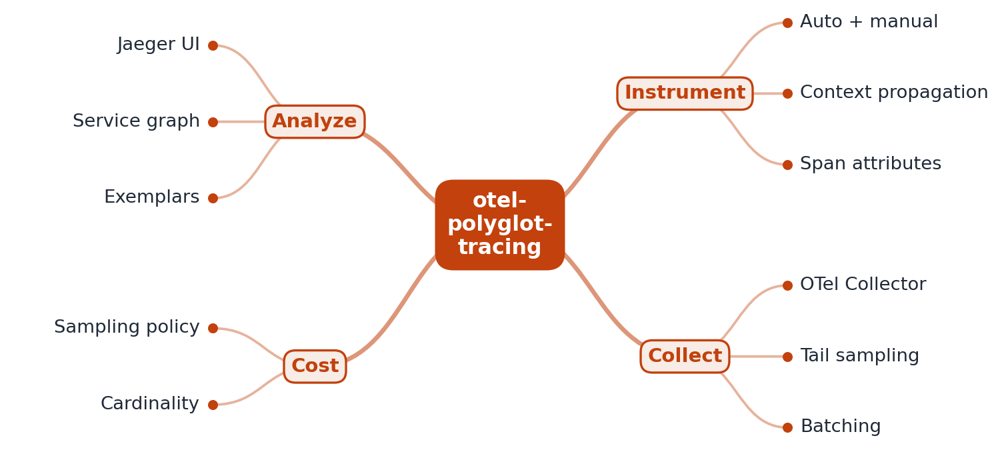

# RFC 0001: otel-polyglot-tracing design

- **Status:** Accepted (M1 implemented)
- **Author:** EquinoxWN
- **Created:** 2026

## Problem

A request that is slow or fails in production usually crosses several services written in
different languages, and part of the path is asynchronous (a queue). Each team's logs and metrics
show its own service as healthy; nobody can see the whole path. Distributed tracing fixes this
only if the trace context survives every hop: an HTTP call from Go to Python, a message through a
queue, a callback from Node.js. The most common failure is silent: the producer does not put the
context into the message headers, the consumer starts a new trace, and the slow or failing part of
the request is now in a trace nobody finds. This project builds three small services in Go,
Python and Node.js that call each other over HTTP and a queue, and proves with a test that one
order is one trace from end to end.

**Users:** backend and platform engineers who own services in more than one language, and
on-call engineers who have to answer "which service made this request slow or fail?".

### Critical-to-quality measures

| CTQ | Measure | Target | M1 result |
|---|---|---|---|
| One trace per request | orders whose trace holds all 11 expected spans, from 3 languages, with the expected parent of every span | 100 % | 21/21 ([results](../results/m1.md)) |
| Context crosses the queue | consumer span's parent is the producer span (W3C `traceparent` in the message headers) | 100 % | 21/21; without injection 0/5 (baseline) |
| No context leakage | spans carrying another order's `order.id`, or orders sharing a trace ID, under 20 concurrent orders | 0 | 0 |
| Failure is attributed | in a failed order, the business span marked ERROR belongs to the service that failed | the failing service only | `inventory/inventory.reserve` only |
| Hostile headers are harmless | malformed, oversized or non-string trace headers crash a service or attach to a wrong trace | 0 | 0 (unit tests in all three languages) |
| Spans arrive quickly | time from span end to arrival at the OTLP receiver (batch delay 100 ms) | < 1 s | 146 ms max |
| Known vulnerabilities | govulncheck, pip-audit, npm audit findings | 0 | 0 |

## Goals

- Three services, one per language, that call each other over HTTP and a queue:
  Go gateway, Python (FastAPI) inventory, Node.js (TypeScript) fulfillment worker.
- OpenTelemetry SDKs create spans automatically (`otelhttp` in Go, FastAPI instrumentation in
  Python, undici/fetch instrumentation in Node.js), plus custom spans for business steps
  (`order.validate`, `inventory.reserve`, `fulfillment.ship`, `order.mark_shipped`).
- W3C trace context (`traceparent`, `tracestate`) is carried over HTTP by the instrumentation and
  through the queue by explicit inject (producer) and extract (consumer) on message headers.
- An end-to-end test that runs the real processes and checks the exported spans, not just status codes.
- Later: Collector tail sampling (M2), Jaeger search and dependency graph (M2), exemplars and a
  head-vs-tail sampling cost comparison (M3).

## Non-goals

- A production order system. Stock is in memory, orders are kept in a bounded in-memory map.
- A production message broker. The queue is a SQLite table (see ADR 0002); M1 is about context
  propagation, which works the same way with Kafka or AMQP headers.
- Docker in M1. Everything runs as local processes so the test runs on a laptop and in CI alike.

## Proposed design



```
client ─HTTP─► gateway (Go) ─HTTP─► inventory (Python/FastAPI) ─INSERT─► messages (SQLite)
                   ▲                                                         │ claim
                   └──────────────HTTP POST /orders/{id}/shipment──── fulfillment (Node.js)
all three ──OTLP/HTTP protobuf──► receiver (OTel Collector in M2; an in-process stub in the e2e test)
```

Trace of one order (11 spans):

| Service | Span | Kind | Parent |
|---|---|---|---|
| gateway | `POST /orders` | SERVER | caller's `traceparent`, or root |
| gateway | `order.validate` | INTERNAL | `POST /orders` |
| gateway | `POST /reservations` | CLIENT | `POST /orders` |
| inventory | `POST /reservations` | SERVER | gateway CLIENT |
| inventory | `inventory.reserve` | INTERNAL | inventory SERVER |
| inventory | `publish orders` | PRODUCER | inventory SERVER |
| fulfillment | `process orders` | CONSUMER | `publish orders` (from the message headers) |
| fulfillment | `fulfillment.ship` | INTERNAL | `process orders` |
| fulfillment | `POST` (fetch) | CLIENT | `fulfillment.ship` |
| gateway | `POST /orders/{id}/shipment` | SERVER | fulfillment CLIENT |
| gateway | `order.mark_shipped` | INTERNAL | gateway SERVER |

Key decisions:

- **Same configuration in every language.** Each service reads only the standard
  `OTEL_EXPORTER_OTLP_*` and `OTEL_BSP_*` variables and sets `service.name`; the SDK adds
  `telemetry.sdk.language`, which the test uses to prove three languages are in one trace.
- **Queue headers.** The producer injects the context while the PRODUCER span is current, so the
  consumer's parent is the publish step. The consumer extracts from `ROOT_CONTEXT`, never from
  whatever context is active, so one message's trace cannot leak into the next. Header parsing is
  strict (at most 16 string headers of at most 1,024 characters); anything malformed means "no
  context", and the W3C propagators reject invalid `traceparent` values, so bad input starts a new
  trace instead of failing the message.
- **One schema, checked.** `spec/queue.sql` is the queue contract; the Python and Node.js code
  each embed it and a test in each language fails if they drift.
- **Validation before side effects.** The gateway (4 KiB body, strict JSON, SKU and quantity
  rules), the inventory (pydantic strict model, 4 KiB body limit) and the worker (exact body shape)
  reject bad input before any downstream call; order ids are 16 hex characters, so they cannot
  change a URL path.
- **At-least-once delivery.** Claims expire after a visibility timeout, failures retry up to
  three attempts, poison messages go to `dead` at once, and the shipment callback is idempotent.

## Alternatives considered

| Option | Why not (yet) |
|---|---|
| Kafka, RabbitMQ or NATS as the queue | Real brokers, and their client libraries have tracing plug-ins. They need Docker or a separate server on this machine, and the plug-ins would hide the inject/extract step this project exists to show. The SQLite queue has the same header model; a broker can replace it behind the same two functions. ADR 0002. |
| OpenTelemetry Collector (or Jaeger) as the receiver in the test | The real path for M2. For M1 the test needs to read spans back programmatically and fail on a wrong parent; an in-process OTLP/HTTP receiver decodes the same protobuf the Collector receives and needs no Docker or downloaded binary. |
| Links instead of parent/child across the queue | The OpenTelemetry messaging conventions allow either. With one message per process call, parent/child gives one trace per order, which is what an on-call engineer searches for; links fit batch consumers (several producers per process span) and are left for later. |
| Zero-code auto-instrumentation agents (`opentelemetry-instrument`, `--require @opentelemetry/auto-instrumentations-node`, eBPF for Go) | Less code, but more dependencies and less control; the queue still needs manual inject/extract, which is the point of M1. |
| B3 or vendor headers | W3C trace context is the default of every OpenTelemetry SDK and the standard; one propagator everywhere avoids translation bugs. |

## Measurement plan

- **M1:** unit tests per language for propagation, validation and queue semantics; an end-to-end
  test that starts the three services as processes on 127.0.0.1, sends 20 concurrent orders, one
  order with a caller-supplied `traceparent` and one sold-out order, and checks every span, parent,
  language and `order.id` (CTQ table above). The same test with propagation off measures the
  baseline. Numbers are recorded in [docs/results/m1.md](../results/m1.md).
- **M2:** the Collector's tail sampler keeps 100 % of error and slow traces and a set share of the
  rest, checked by counting traces in Jaeger.
- **M3:** inject a slow query and find it from the trace; compare stored bytes for head vs tail
  sampling at the same error-trace recall.

## Milestones

- **M1 (done):** three services over HTTP and a queue, automatic and custom spans, W3C trace
  context across languages and through the queue, end-to-end test.
- **M2:** Collector tail sampling; Jaeger search and service dependency graph.
- **M3:** metric exemplars to traces; head vs tail sampling cost write-up; slow-query demo.

## Risks and open questions

- The undici instrumentation names client spans `POST` (method only, per semantic conventions);
  the test matches that span by service and kind, not by name.
- SQLite allows one writer at a time; under 20 concurrent orders the `publish orders` span grew to
  about 240 ms (see results). Fine for a demo, not for throughput; a broker replaces it.
- Clocks: all spans come from one machine here; across hosts, clock skew can make a child appear
  to start before its parent. Parentage, not timestamps, is what the test asserts.
